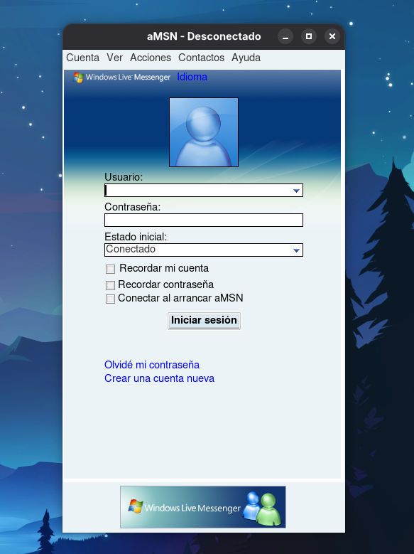

# aMSN Escargot



This repository contains a fork of **aMSN 0.98.9**, an open-source instant messaging client written mainly in Tcl/Tk. It is adapted to connect to **Escargot**, a community service compatible with MSN Messenger: Escargot servers are used as defaults, along with the MSNP12/TWN sign-in flow. This is a client, not a server; you need a valid Escargot account to sign in.

The code retains native components and packaging tools from the legacy aMSN project. Build and packaging requirements may vary with your operating system and Tcl/Tk version.

## Requirements

- Tcl/Tk 8.5 or later, including development headers to build the native extensions.
- C and C++ compilers, `make`, and standard build tools.
- PNG, JPEG, and zlib development libraries for the image extensions.
- **TclTLS** for secure authentication and dispatch connections. It is a separate Tcl package; without it, sign-in may fail.

### Arch Linux

Install the compiler toolchain, Tcl/Tk, image libraries, and TclTLS:

```sh
sudo pacman -S --needed base-devel tcl tk libpng libjpeg-turbo zlib
```

TclTLS is in the AUR as `tcltls`; for example, with `yay`:

```sh
yay -S tcltls
```

### Ubuntu

Install the build tools, development headers, and TclTLS:

```sh
sudo apt update
sudo apt install build-essential tcl-dev tk-dev libpng-dev libjpeg-dev zlib1g-dev tcl-tls
```

If `apt` cannot find `tcl-tls`, enable the Ubuntu `universe` repository and retry.

## Build on Linux

From the repository root, run:

```sh
cd amsn-0.98.9-escargot
./configure
make
```

To run the client without installing it:

```sh
./amsn
```

To install it under the prefix detected by `configure` (usually `/usr/local`):

```sh
sudo make install
```

If `configure` reports missing Tcl/Tk files or libraries, install the corresponding development packages. If the build succeeds but sign-in reports a TLS error, make sure TclTLS is installed for the same Tcl installation used to run aMSN. Ubuntu packages are listed in the [Ubuntu package index](https://packages.ubuntu.com/); Arch packages are listed in the [Arch package database](https://archlinux.org/packages/), while `tcltls` is distributed through the [AUR](https://aur.archlinux.org/packages/tcltls).

## Quick check

1. Start aMSN with `./amsn`.
2. Check that the selected protocol is MSNP12 and the server points to Escargot.
3. Sign in with an Escargot account and verify TclTLS loads successfully.

User configuration and profiles are stored outside the repository, in aMSN's per-user data directory.

## How to connect to Escargot

1. Create an Escargot account at [account.escargot.chat/register](https://account.escargot.chat/register). Choose the **Screenname** account type for MSN-compatible sign-in, complete registration, and activate the account if prompted. A Microsoft account does not work with Escargot.
2. Start aMSN and enter your Escargot screen name in the sign-in field with the service suffix, in this form: `yourname@escargot.chat`.
3. Enter the password for your Escargot account and sign in. This fork defaults to Escargot's MSNP12 connection settings.

For more details, see Escargot's [getting started guide](https://escargot.chat/connect/).

## Known issues

- **Voice calls are not currently buildable with modern Linux multimedia libraries.** The bundled Farsight extension and `configure` checks target the legacy GStreamer 0.10/Farsight APIs. Current distributions provide newer GStreamer and Farstream versions, so installing their packages alone does not enable voice calls; the extension and build checks need a port. This does not affect sign-in or text chat.
- Audio clips and notifications use separate optional components, including Snack and `tcl_siren`; their availability depends on the system installation.

## License

aMSN is distributed under the GNU General Public License, version 2 or (at your option) any later version. See [`LICENSE`](LICENSE).
